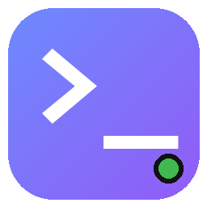

<p align="center">
  
</p>

<h1 align="center">OpenCode Desktop</h1>

<p align="center">OpenCode CLI 的非官方 Windows 桌面客户端</p>

OpenCode Desktop 使用 Python、pywebview 和 WebView2 为 OpenCode CLI 提供一个原生窗口界面。它负责本地界面、会话展示、文件与图片附加、消息排队和权限交互，实际的模型调用与会话数据仍由 OpenCode CLI 处理。

> 本项目为非官方社区项目，与 OpenCode 官方无隶属关系。

## 功能

- 会话管理：新建、切换、重命名、删除和搜索会话
- 模型、Agent 和推理强度选择
- Markdown、代码高亮、思考过程和工具调用展示
- 图片粘贴、拖入或选择，本地文件路径附加
- 生成过程中继续发送消息，自动排队并在下一分段插入
- 队列暂停、继续、清空和失败重试
- 工具权限确认、问题选择，以及可选的自动允许权限
- 任务完成、失败、需要授权或选择时的 Windows 系统通知
- 浅色/深色主题、标题栏同步、背景图片和透明度设置
- 上下文用量、Token 统计、耗时和费用展示
- OpenCode 命令与技能列表
- 桌面设置、主题和背景图持久化

## 系统要求

- Windows 10 或 Windows 11，64 位
- Python 3.11 或更高版本，推荐 64 位 Python 3.13
- [OpenCode CLI](https://opencode.ai) 已安装并登录
- Microsoft Edge WebView2 Runtime
- 可访问所选模型服务的网络环境

缺少 WebView2 Runtime 时，应用会尝试使用附带或自动下载的安装程序进行安装。

## 快速开始

### 使用启动脚本

1. 克隆仓库：

   ```powershell
   git clone git@github.com:laoyinaaa/opencode-Desktop.git
   cd opencode-Desktop
   ```

2. 确认 OpenCode CLI 可用：

   ```powershell
   opencode --version
   ```

3. 双击 `启动.bat`。首次运行会自动创建 `.venv` 并安装依赖。

4. 首次使用时登录 OpenCode，选择项目文件夹，然后点击“开始使用”。

如果启动失败，可以双击 `调试启动.bat` 查看控制台错误。

### 手动运行

```powershell
py -3.13 -m venv .venv
.venv\Scripts\python.exe -m pip install -r requirements.txt
.venv\Scripts\python.exe app.py
```

也可以直接使用已安装的 Python：

```powershell
python -m pip install -r requirements.txt
python app.py
```

## 使用提示

- 回车发送消息，`Ctrl+Enter` 换行。
- 输入框以 `/` 开头会显示 OpenCode 命令和技能列表。
- 文件和图片可以点击按钮选择、直接拖入或粘贴到输入框。
- 文件本身不会上传，应用会把本地绝对路径交给 Agent 读取。
- 模型工作时发送的新消息会排队，并在当前任务的下一分段插入。
- 单个会话最多排队 20 条消息，附件总量最多 64 MB。
- 排队消息只保存在当前应用内，关闭应用或重启服务后会丢失。
- 图片和提示词会发送给你选择的模型提供商，请注意内容隐私。
- 自动允许权限只应在信任当前项目时开启。

## 数据位置

桌面应用自身的数据保存在：

```text
%APPDATA%\opencode-desktop\
```

主要包括：

- `config.json`：项目路径、主题、背景图透明度等桌面设置
- `serve.log`：OpenCode 服务日志
- `desktop.log`：桌面应用启动错误日志
- `wallpaper.bin`：背景图片
- `webview\`：WebView2 本地存储

OpenCode 的登录凭据由 OpenCode CLI 管理，默认位于：

```text
%USERPROFILE%\.local\share\opencode\auth.json
```

本仓库不包含账号、API Key 或登录凭据。

## 构建发布包

构建脚本需要 Windows、PowerShell 和已安装的 OpenCode CLI。

```powershell
powershell -ExecutionPolicy Bypass -File .\build-release.ps1
```

脚本会：

1. 创建或复用 `.build-venv` 构建环境
2. 安装 PyInstaller 依赖
3. 下载并校验 WebView2 安装程序
4. 定位 OpenCode CLI
5. 生成便携版和源码版发布包

生成结果位于 `release\`，该目录不会提交到 Git。可以通过 `OPENCODE_CLI_SOURCE` 环境变量指定 OpenCode CLI 路径：

```powershell
$env:OPENCODE_CLI_SOURCE = "C:\path\to\opencode.exe"
.\build-release.ps1
```

## 项目结构

```text
app.py                    桌面应用主程序
static/                   前端界面资源
  app.js                  界面逻辑
  app.css                 界面样式
  index.html              页面结构
  vendor/                 Markdown、高亮和清理库
packaging/                构建配置和说明文件
build-release.ps1         发布包构建脚本
requirements.txt          运行依赖
requirements-build.txt    构建依赖
启动.bat                  正常启动
调试启动.bat              带控制台调试启动
```

## 常见问题

**提示未找到 Python**

安装 64 位 Python 3.11 或更高版本，并在安装时勾选 `Add python.exe to PATH`。

**依赖安装失败**

检查网络和代理设置，删除 `.venv` 后重新运行 `启动.bat`。也可以运行 `调试启动.bat` 查看详细错误。

**提示 WebView2 不可用**

安装 Microsoft Edge WebView2 Runtime，或重新运行启动脚本让应用尝试自动安装。

**应用无法写入文件**

不要将程序放在 `Program Files` 等只读目录。首次运行需要在程序目录创建 `.venv`。

**OpenCode 服务异常**

检查 `%APPDATA%\opencode-desktop\serve.log` 和 `desktop.log`，确认 `opencode --version` 可以正常运行，然后重启应用。

## 技术栈

- Python 3
- pywebview / WebView2
- aiohttp
- 原生 HTML、CSS 和 JavaScript
- PyInstaller

## 许可证

本仓库暂未添加开源许可证。如需分发或复用，请先补充合适的许可证文件。
